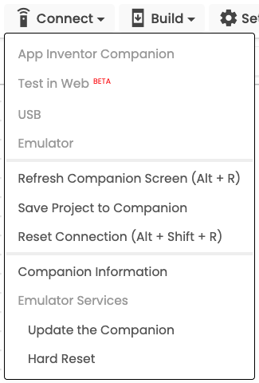

# WebEmu

This directory contains several sample MIT App Inventor projects to try out with the Web Emulator (WebEmu) now built into [MIT App Inventor](htps://appinventor.mit.edu/) with *Test in Web*.

Projects include:

-  [WebEmuMoleMash](https://code.appinventor.mit.edu/?repo=https://raw.githubusercontent.com/dcpetty/mit-app-inventor/refs/heads/main/WebEmu/WebEmuMoleMash.aia)
-  [WebEmuPiano](https://code.appinventor.mit.edu/?repo=https://raw.githubusercontent.com/dcpetty/mit-app-inventor/refs/heads/main/WebEmu/WebEmuPiano.aia)

<a href="https://dcpetty.github.io/mit-app-inventor/WebEmu/">&#128279; permalink</a> 
<a href="https://github.com/dcpetty/mit-app-inventor/tree/main/WebEmu">&#128230; repository</a> 
<!-- 
PERMALINK: https://dcpetty.github.io/mit-app-inventor/REPO/
REPOSITORY: https://github.com/dcpetty/mit-app-inventor/tree/main/REPO
MIT APP INVENTOR: https://code.appinventor.mit.edu/?repo=https://raw.githubusercontent.com/dcpetty/mit-app-inventor/refs/heads/main/REPO/REPO.aia
-->

